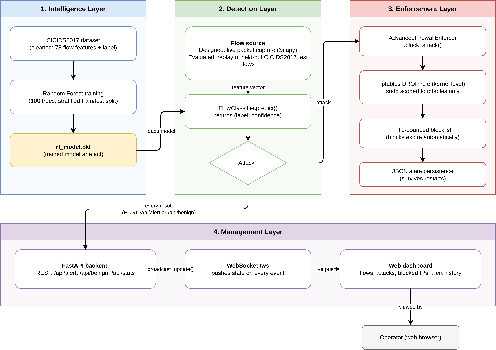

# An Open-Source Machine Learning-Based Network Firewall

Source code of the BSc thesis *An Open-Source Machine Learning-Based Network Firewall*
(Leon Reich Ssali, University of Dunaújváros, Institute of Information Technology, 2026).

The system classifies network flows with a Random Forest trained on the CICIDS2017 dataset,
blocks the sources of malicious flows with iptables DROP rules that expire after a time-to-live,
and shows every detection on a live web dashboard.

> **Research prototype.** Developed and evaluated on Ubuntu 22.04 under WSL2 with replayed
> benchmark flows. It is not intended for production networks (see Chapter 7 of the thesis).

## Architecture

| Layer | Files | Purpose |
|---|---|---|
| Intelligence | `src/01_data_cleaning.py`, `src/02_model_trainer_v2.py` | Merge and clean CICIDS2017; train, evaluate and save the classifier |
| Detection | `src/09_classifier.py` | Load the model; classify a flow and return label and confidence |
| Enforcement | `src/11_firewall_enforcement_advanced.py` (original), `src/12_firewall_enforcement_v2.py` (corrected) | Apply and expire iptables blocks; persist state |
| Management | `src/dashboard_phase5.py`, `src/dashboard.html` | REST and WebSocket backend; live dashboard |
| Integration | `src/integration_detection_enforcement*.py` | Replay flows through detection and enforcement; report to the dashboard |
| Verification | `tests/`, `src/measure_latency.py` | Automated tests and latency measurement |

The three `integration_detection_enforcement` files are successive versions kept for reference;
`_v3` is the latest.



## Requirements

- Ubuntu 22.04 (native or WSL2), Python 3.11, iptables
- The CICIDS2017 dataset (MachineLearningCVE CSV files), available from the
  Canadian Institute for Cybersecurity: https://www.unb.ca/cic/datasets/ids-2017.html

## Installation

```bash
git clone https://github.com/llazyleon/ml-network-firewall.git
cd ml-network-firewall
python3 -m venv venv && source venv/bin/activate
pip install -r requirements.txt
```

The enforcement engine runs iptables through sudo. Allow this for the iptables binary only
(replace `<user>` with your Linux user name; edit with `sudo visudo -f /etc/sudoers.d/ml-firewall`):

```
<user> ALL=(ALL) NOPASSWD: /usr/sbin/iptables
```

## Quick demo with the included sample

The repository includes a small sample of the cleaned dataset (`data/sample/cicids2017_sample.csv`,
3,167 flows covering all 15 traffic classes: 2,409 benign and 758 attack flows). The trained model
used in the thesis (`rf_model.pkl`, 78 features) is supplied in the thesis submission folder; place it
in `data/models/`, or recreate it from the full dataset with the training script (see Usage below).

```bash
# with rf_model.pkl in data/models/
mkdir -p data/processed
cp data/sample/cicids2017_sample.csv data/processed/cicids2017_cleaned.csv
python3 src/dashboard_phase5.py                      # terminal 1, then open http://localhost:8000
python3 src/integration_detection_enforcement_v3.py  # terminal 2
```

With the sample, the replay uses a smaller held-out set than in the thesis (about 120 flows instead of 300).
Do not run the training script on the sample: it would overwrite the thesis model with one trained on 3,167 flows.

## Usage (full dataset)

All commands are run from the repository root.

1. **Prepare the data.** Copy the CICIDS2017 CSV files into `data/raw/`, then:
   ```bash
   python3 src/01_data_cleaning.py          # -> data/processed/cicids2017_cleaned.csv
   ```
2. **Train the model.**
   ```bash
   python3 src/02_model_trainer_v2.py       # -> data/models/rf_model.pkl
   ```
3. **Start the dashboard** and open http://localhost:8000 in a browser.
   ```bash
   python3 src/dashboard_phase5.py
   ```
4. **Run the system.** In a second terminal, replay held-out flows through detection and enforcement:
   ```bash
   python3 src/integration_detection_enforcement_v3.py
   ```
5. **Check the blocks:** `sudo iptables -L INPUT -n`

## Tests

```bash
# Enforcement engine: corrected version (all 25 tests pass)
ENFORCER_MODULE=src/12_firewall_enforcement_v2.py python3 -m pytest tests/test_enforcement.py -v

# Original version (11 tests fail; these failures are the defects described in Chapter 5)
python3 -m pytest tests/test_enforcement.py -v

# Trained model (requires data/models/rf_model.pkl)
python3 -m pytest tests/test_model.py -v

# Inference latency
python3 src/measure_latency.py
```

The integration tests (I01–I03) use real iptables on the documentation address 203.0.113.77
(RFC 5737) and need the sudo rule above; they are skipped otherwise.

## Results (held-out test set, 113,115 flows)

| Accuracy | Precision | Recall | F1-score |
|---|---|---|---|
| 99.86% | 99.69% | 99.58% | 99.63% |

Detection of rare classes is weaker (e.g. Bot: 46.27%), and the prototype makes about
15 single-flow predictions per second. See Chapter 6 of the thesis for the full evaluation.

## Repository contents

```
src/            source code
tests/          automated tests (pytest)
data/raw/       CICIDS2017 CSV files (not included)
data/processed/ cleaned dataset (generated)
data/sample/    sample of the cleaned dataset (3,167 flows, all classes)
data/models/    trained model (supplied in the submission folder, or generated)
docs/diagrams/  architecture, runtime and training diagrams (PNG and draw.io)
docs/screenshots/ screenshots used in the thesis
```

## License

MIT, see [LICENSE](LICENSE).
